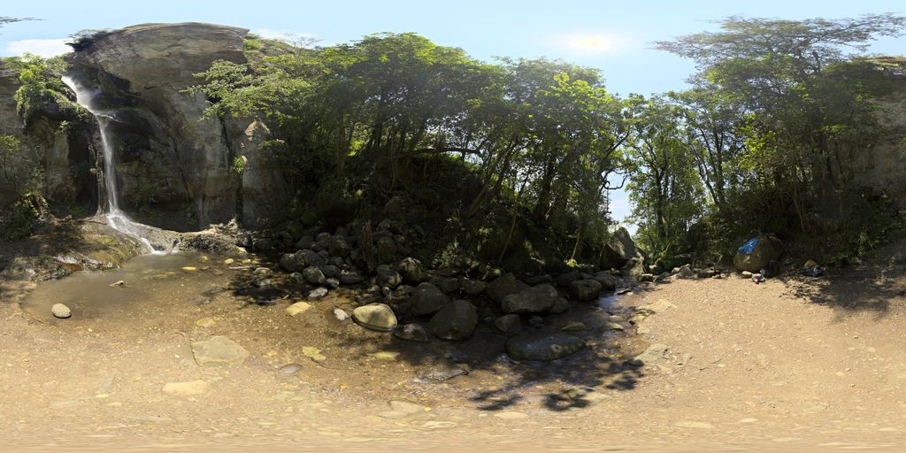

# LandscapeSound · 景观听见

[English](README.md) | [简体中文](README.zh-CN.md)

**Turn a panorama into an image-guided spatial soundscape and Chinese narration.**

LandscapeSound is a Windows-first research prototype for image-guided soundscape previews: panorama interpretation, local audio generation, spatial playback, and neural Chinese narration.

Upload a complete 360° panorama to automatically run GPT image interpretation, generate audio for that image, and synthesize a Chinese guide. Switch between four viewing directions while comparing the picture with the sound, and stop playback or narration at any time. The sound is a simulation designed from the image, **not a field recording of the photographed location**.

The application interface, saved-example pages and documentation support **English and Simplified Chinese**. Generated narration currently remains in **Chinese**. Switching the interface language does not regenerate or translate the audio.

[Listen to the demo](#listen-to-the-existing-demo) · [Install and run](#install-and-run-the-application) · [Architecture](docs/architecture.md) · [Third-party notices](THIRD_PARTY_NOTICES.md) · [Audio runtime](audio_model/README.md)



Photography: [Crystal Falls](https://polyhaven.com/a/crystal_falls) · Greg Zaal · [Poly Haven CC0](https://polyhaven.com/license). The image is a thumbnail of the complete panorama; generated audio is identified separately.

## Listen to the existing demo

The [demo_public](demo_public/index.html) directory contains a lightweight presentation of four public photographic panoramas, generated soundscapes, and neural female narration. The entire listening package is approximately 2.1 MB. Images are thumbnails of complete equirectangular panoramas (ERP), soundscapes are lossy OGG Vorbis listening copies, and narration retains the original MP3 files. Listening to these saved results does not require model downloads or a GPT login. You can open its `index.html` directly in a browser.

GitHub's source view does not execute HTML. After downloading or cloning the repository, optionally serve the project directory locally:

```powershell
py -3.11 -m http.server 8502 --bind 127.0.0.1
```

Open <http://127.0.0.1:8502/demo_public/?lang=en>. This page plays saved results; uploading a new image requires the main application described below.

After starting the application, **“先听一个已完成示例”** (“Listen to a completed example”) can also load this bundled demo without a separate static server, model downloads, or a GPT request.

| New scene | Photography source | Generated result |
| --- | --- | --- |
| Shallow woodland stream and low cascades | [Monbachtal Riverbank](https://polyhaven.com/a/monbachtal_riverbank) | An independent water track and guide for this image |
| Rock-face waterfall and pool | [Crystal Falls](https://polyhaven.com/a/crystal_falls) | An independent flowing-water track and guide for this image |
| Sandy and rocky beach with nearshore wave lines | [Secluded Beach](https://polyhaven.com/a/secluded_beach) | An independent surf track and guide for this image |
| Residential street with parked vehicles | [Urban Street 03](https://polyhaven.com/a/urban_street_03) | Explicitly hypothetical sparse road sounds and a guide |

The photographs are CC0 assets from Poly Haven. Their authors and processing details are retained in the public demo metadata. Photography, generated audio, and neural narration have separate provenance and applicable terms.

## Features

- Upload a complete 2:1 equirectangular panorama and automatically create four 90° perspective views: front, right, back, and left.
- Run semantic segmentation and relative-depth estimation locally, and inspect the original image and analysis layers.
- Interpret the current image through the official Codex client signed in with ChatGPT, recording visible facts, sound-simulation assumptions, and uncertainty separately.
- Generate the necessary independent tracks locally with Stable Audio 3 Medium. Supported classes include streams, surf, road ambience, wind, foliage, and gentle water ripples.
- Synthesize a Chinese neural guide for the image. Starting narration stops the soundscape, starting the soundscape stops narration, and the stop button stops both.
- Verify and resume local tasks, retaining completed stages after a failure. A completed result for the same original file can be loaded from cache.
- Export the image-specific plan, audio provenance, guide text, and directional settings. Ordinary-photo mode also retains local analysis and correction controls.

The four directions of one panorama share that panorama's tracks, with sounds positioned according to visible features in each view. A direction without an assigned visual proxy source remains silent, while the panorama guide remains available.

## Current results and limitations

**Stream audio can still resemble rain; this problem is not solved.** Four new images were run through the main application, but exploratory content diagnostics exposed limited generalization of the flowing-water approach.

| Check | Observation from this round |
| --- | --- |
| Shallow stream | CLAP similarity to the stream label was 0.535, compared with 0.620 for rain, indicating remaining rain-confusion signals |
| Rock-face waterfall | Stream: 0.638; rain: 0.619; waterfall: 0.463. The larger water-flow scale was not conveyed well |
| Different water scenes | The two new flowing-water tracks had audio-representation similarity of 0.861, with insufficient separation; beach and flowing-water representations were also relatively close |
| Street | Similarity to the three water scenes was approximately 0.200–0.263, showing clearer separation |
| Chinese narration | Four Xiaoxiao guides were approximately 25.7–27.8 seconds long. Text, audio fingerprints, and playback checks passed; no naturalness score was assigned |

These CLAP values are exploratory comparisons of content representations, **not human recognition rates, naturalness ratings, or event probabilities**. Scores refer to uncompressed comparison WAV files with a common 28-second duration and approximately −23 LUFS. The public OGG files are lossy listening copies and were not re-scored. New and historical images differ, so differences between rounds cannot be attributed solely to prompt improvements.

Relative depth and virtual radius are not metric distance measurements and cannot be directly compared between views. A static image cannot establish actual wind speed, water flow, traffic movement, loudness, or passability. This prototype supports landscape-preview research. It has not demonstrated improved spatial understanding or user experience for blind or low-vision users, and must not be used for navigation, obstacle avoidance, or safety decisions.

## Install and run the application

### Environment

The primary supported setup is **Windows 10/11 with Python 3.11**. The tested machine used an Intel i9-14900HX, 32 GB RAM, and an NVIDIA RTX 4060 Laptop GPU with 8 GB VRAM. Image models can use CUDA or CPU. The current audio generator uses a separate LiteRT/TFLite **CPU** environment; it does not require loading the audio model onto the GPU.

Initial installation requires an internet connection to download Python dependencies and model weights, and several GB or more of free disk space. The repository does not include model weights, virtual environments, original large photographs, or historical local tasks.

If you have not obtained the source yet:

```powershell
git clone https://github.com/churi919/LandscapeSound.git
cd LandscapeSound
```

### 1. Install the image-analysis environment

Run from the project root:

```powershell
powershell -ExecutionPolicy Bypass -File .\install_windows.ps1 -InstallNarration
```

This installs the CUDA 12.8 build of PyTorch by default. To use CPU on a machine without a suitable NVIDIA GPU:

```powershell
powershell -ExecutionPolicy Bypass -File .\install_windows.ps1 -TorchBackend cpu -InstallNarration
```

The installation downloads SegFormer B0 and Depth Anything V2 Small. SegFormer uses NVIDIA's research/evaluation non-commercial license; read the [third-party notices](THIRD_PARTY_NOTICES.md) before use. Existing model downloads can be reused. Add `-SkipModelDownload` to install only the main environment.

### 2. Install the separate audio environment

Read the [Stable Audio Community License](audio_model/model_LICENSE.md), [Gemma terms](audio_model/model_LICENSE_GEMMA.md), and [audio runtime notes](audio_model/README.md). After checking that their conditions apply to your intended use, explicitly run:

```powershell
powershell -ExecutionPolicy Bypass -File .\audio_model\install_windows.ps1 -IncludeMedium -AcceptModelLicense
```

The script retrieves pinned versions of the official runtime and model. They remain in local directories ignored by Git and are not redistributed as this project's code. The audio environment is separate from the main `.venv` and narration `.venv_narration` environments.

### 3. Prepare the GPT login

Install the official Codex client and sign in normally with your ChatGPT account on the local machine. The application finds the official executable through its installation path or `PATH`. If necessary, set `LANDSCAPESOUND_CODEX_EXE` to its path on your own machine.

The bridge was tested with Codex CLI `0.164.0-alpha.11.1` and uses the fixed model identifier `gpt-6.1-sol`. Your account, client version, and available quota must support that identifier. This route uses **the official client's signed-in session, not automated clicking in the ChatGPT website**, and does not require storing an API key in this project. Do not copy login files, tokens, or browser profiles into the repository. When GPT is unavailable, the task stops explicitly and retains completed stages; local classification rules are not substituted as if they were GPT interpretation.

### 4. Start the application

Double-click `start_windows.bat`, or run:

```powershell
.\.venv\Scripts\python.exe -m streamlit run app.py --server.address 127.0.0.1 --server.port 8501
```

Open <http://127.0.0.1:8501/?lang=en>. Panorama upload is selected by default. Confirm that the image covers a complete 360° × 180° panorama to start the five-stage workflow automatically. An ordinary wide photograph is not a spherical panorama merely because it has a 2:1 aspect ratio.

Use the sidebar's **中文 / English** control to switch language. Saved examples, scene comparisons and the in-app guides keep the chosen language when you follow their links. You can also open the [Chinese interface](http://127.0.0.1:8501/?lang=zh-CN) directly. The saved-example and comparison pages run inside the main application without a second static server. Existing Chinese guide text is identified as original content in the English interface.

After refreshing, use **“继续查看最近的全景任务”** (“Continue recent panorama tasks”) to recover local results. If a task fails, select **“继续自动生成”** (“Continue automatic generation”) to complete missing stages. To exit, press Ctrl+C in the launch terminal, or use `stop_windows.ps1` to stop this project's service.

## Network use

| Stage | Data sent or downloaded | Once cached |
| --- | --- | --- |
| Initial environment/model preparation | Python dependencies and model-weight downloads | Image and audio inference run locally |
| GPT interpretation of a new image | The current panorama/four-view contact sheet and task text are sent to the GPT service | A complete task for the same original file can be loaded locally |
| Neural narration of new text | Guide text is sent to Microsoft's online speech service through `edge-tts` | An MP3 matching the exact text can be played offline |
| Browser soundscape playback | Locally generated audio is rendered with Web Audio | Playback itself does not require regeneration |

Xiaoxiao is a neural synthetic voice, not a human recording. `edge-tts` is a third-party client; service availability and applicable conditions are determined by the service provider.

## Project structure

```text
app.py / ui_theme.py             Main interface and readability styling
ui_i18n.py / site_pages.py       Session language and matching website pages
panorama_ui.py                   Upload, recovery, and four-view inspection
panorama_pipeline.py             Five-stage tasks, cache checks, and recovery
gpt_cli_bridge.py / gpt_scene_audio.py
                                GPT image entry point and structured plans
analyzer.py / panorama.py        Local image models and panorama conversion
scene_audio_runtime.py           Separate audio process and postprocessing
audio_model/                    Audio scripts, pinned versions, and notices
narration.py / synthesize_narration.py
                                Exact-text narration cache and synthesis
audio_player* / browser_audio.py Browser spatial playback and controls
tests/                          Engineering tests
demo_public/                    Lightweight publishable results and sources
docs/architecture.md            Implementation and data boundaries
```

Runtime files are created locally in `models/`, `.cache/`, `assets/`, and `outputs/`. These directories are not uploaded with the public repository; installation and execution create the required files. Historical records on the research machine remain local.

## Validation

```powershell
python -m pip install -r requirements-test.txt
python -m pytest tests -q
```

In a clean source copy without models, historical outputs, original photographs, or the local runtime environments, the project tests produced **160 passed**. The tests do not require a GPT login or online narration. Node.js enables 3 browser-script checks; those 3 checks are explicitly skipped when Node is absent. `pytest.ini` separates project tests from tests in downloaded third-party code. Engineering checks cover cache identity, parsing, recovery, audio processing, and control logic; they do not establish segmentation accuracy, soundscape naturalness, or target-user outcomes.

## Sources and licensing

See [THIRD_PARTY_NOTICES.md](THIRD_PARTY_NOTICES.md). Models, dependencies, photography, generated effects, and narration each remain subject to their applicable conditions.

An open-source license has not yet been specified for this project's original code. Public visibility does not grant a general right to copy, modify, or redistribute it. Third-party assets must not be treated as if they were all covered by an MIT license.
