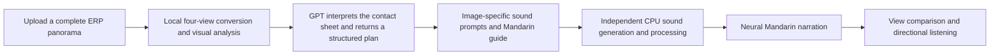

# Architecture

[English](architecture.md) | [简体中文](architecture.zh-CN.md)

[Back to the project guide](../README.md)

LandscapeSound records image analysis, GPT interpretation, sound generation, narration, and playback separately. Each stage has an explicit input. If a task fails, completed work is retained rather than replaced with results belonging to another image.

## Five stages for a new panorama

| Stage | Main files | Behavior |
| --- | --- | --- |
| Image preparation and analysis | `panorama.py`, `analyze_panorama.py`, `analyzer.py` | Validate a complete 2:1 ERP input; produce four horizontal 90° perspective views; run SegFormer B0 and Depth Anything V2 Small locally |
| GPT interpretation | `gpt_cli_bridge.py` | Use the official Codex CLI with an existing local ChatGPT login to send the current panorama/four-view contact sheet and instructions; receive strict JSON |
| Soundscape plan and guide | `gpt_scene_audio.py`, `panorama_pipeline.py` | Store visible facts, assumptions about dynamic sounds, and uncertainties separately; preserve the image-specific GPT prompt and append acoustic constraints when needed |
| Image-specific sound | `scene_audio_runtime.py`, `audio_model/generate_scene_audio.py` | Run a fixed Stable Audio 3 Medium model in an independent environment; retain the original 30-second stereo output and the processed 28-second material |
| Mandarin guide | `narration.py`, `synthesize_narration.py` | Request Microsoft online neural speech for new text through an independent process; let the player read the cached MP3 matching the exact text |

Visual analysis runs in a separate child process. Once that process exits, its PyTorch/CUDA allocations are released before subsequent stages start. Sound generation does not install LiteRT or its dependencies into the main image-analysis environment.

## Website language and navigation

`ui_i18n.py` resolves `lang=zh-CN` or `lang=en` for each Streamlit session. The interface stores stable widget values independently of their translated labels. `site_pages.py` keeps examples, comparison pages, and documentation in the selected language, including links within documents. These pages use the main application and do not require a separate static server. The standalone saved demo also accepts the same language parameter.

Language selection also selects spoken-guide language. The original visual report, task, sound prompts and environmental tracks are retained. `narration_localization.py` binds translations to the exact original guide and target language. It reads the cache without network access; an explicitly requested missing translation uses the existing isolated GPT client with no tools. The host prepares missing target-language speech once, then reuses it. A failed preparation requires an explicit retry and cannot substitute speech in the other language.

The underlying five-stage job retains its original Chinese guide and audio. English playback uses a separately cached language overlay after that job completes, without rerunning visual or sound generation. English defaults to `en-US-JennyNeural`, with `en-US-GuyNeural` optional; Chinese retains `zh-CN-XiaoxiaoNeural` and `zh-CN-YunxiNeural`. Speech validation binds exact text, voice, synthesis settings, language, audio checksum and duration. Public examples include independent English `.en.mp3` files alongside the preserved Chinese files.

## Task and cache identity

- The SHA-256 of the original uploaded file bytes determines the task directory. Differently encoded files can be different tasks even when they look similar.
- The RGB fingerprint of the local working image binds visual analysis, the GPT plan, and generated audio. A file fingerprint is also retained for the contact sheet actually sent to GPT.
- The sound plan includes the model version, prompts, seeds, and spatial proxies, which establish the sound-cache identity. Both original and processed audio files are checked against their fingerprints.
- Narration is matched by the exact text fingerprint, voice, and synthesis settings. Editing the guide does not silently load an MP3 of the previous text.
- Reading a completed task does not invoke a model. If stage files are missing, modified, or fail verification, the interface requests recovery of valid stages.

Task state is stored locally under `outputs/auto_panorama/`. The main interface launches a hidden background worker and reads its state approximately every two seconds. It avoids starting the same task twice. Sound generation also has a global single-worker lock to prevent multiple images from loading the model concurrently. Windows state files use atomic replacement with bounded retries for sharing conflicts.

## GPT interface boundaries

The bridge uses the official client's normal login. It does not read or copy authentication files, automate the ChatGPT website, or allow the model to perform arbitrary project operations. Requests use an isolated directory, read-only restrictions, and a configuration with tools disabled. Results are rejected if session events include a disallowed tool call. Client diagnostics are distinguished from tool events; only bounded diagnostics and protocol metadata are retained.

The current model identifier is `gpt-6.1-sol`, which must be supported by the installed client and account. A failure leaves the task incomplete. Historical website replies or local category descriptions are not substituted for a GPT result for the current image.

## Sound generation and spatial rendering

The fixed sound-generation configuration is Medium DiT / SAME-L decoder, w8a8, 30 seconds, 8 steps, CFG=1, and 8 CPU threads. CFG=1 does not activate a separate negative-prompt branch. An instruction to “avoid” an event is therefore not a guarantee that the generated audio excludes it.

The original stereo file is retained. Playback material is converted to a mono loop through high-pass filtering, resampling, loop crossfading, shared dynamics processing, and loudness/peak control. The comparison page separately applies global gain matching to equal-length materials to reduce the influence of loudness on judgments.

Web Audio uses the directional proxies for the selected view to provide HRTF binaural rendering or a conventional-mix control. Distance attenuation and low-pass filtering represent virtual near/far relationships only. Regions of the same category are first merged into texture layers to limit repeated stacking. Scene playback and narration stop each other; the stop action clears active sound sources and narration.

Directions within the same panorama may share **that image's** sound track. Different images do not inherit the previous image's generated result. Directions without configured sources remain quiet; this is not a model of real panoramic sound propagation or occlusion. The current implementation has no zenith/nadir analysis, head tracking, or calibrated complete spherical sound field.

## Resource protection

The fixed local sound configuration's historical process-tree peak of approximately 2.0 GiB informs its startup budget: a 2.5 GiB model allowance, a 1.25 GiB system reserve, and a 0.5 GiB margin. Monitoring continues during inference. If system headroom becomes too low, only the task's own generator is stopped; other user applications are not closed. This is a local policy for the current fixed model and should not be generalized to other models.

## Data and validation boundaries

Segmentation and relative-depth outputs remain in the original visual report. GPT's judgments about visible scene content are recorded separately and do not overwrite the model outputs. Depth maps are normalized independently for each view: they are not metric distances, and their values cannot be compared directly across views.

Engineering tests cover parsing, cache identity, failure recovery, scope restrictions, audio processing, and playback control. CLAP measures the proximity of audio representations to predefined text labels. It does not measure naturalness, real-event probabilities, or human listening performance. In this round, the shallow-stream sample remained closer to the rain label than to the stream label, while the waterfall's flow scale was also underrepresented. A successful automatic pipeline does not establish that the sound-quality problems have been resolved.

Model weights, runtime environments, original local tasks, personal photographs, and login material are excluded from the public repository. The public demonstration package contains only attributed photographic copies, simulated soundscapes, neural narration, and metadata with local machine paths removed.
