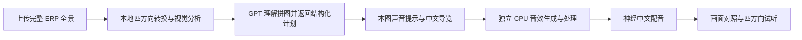

# Architecture

LandscapeSound 将图像分析、GPT 理解、音效生成、配音与播放分开记录。每一步都有明确输入；任务失败时保留已完成内容，避免用不属于当前图片的结果补位。

## 一张新全景的五个阶段

| 阶段 | 主要文件 | 实际行为 |
| --- | --- | --- |
| 图像准备和分析 | `panorama.py`、`analyze_panorama.py`、`analyzer.py` | 校验完整 2:1 ERP；转成四个水平 90° 透视图；SegFormer B0 与 Depth Anything V2 Small 在本机运行 |
| GPT 理解 | `gpt_cli_bridge.py` | 通过本机已登录 ChatGPT 的官方 Codex CLI，发送当前全景／四方向拼图与要求；返回严格 JSON |
| 声景计划与导览 | `gpt_scene_audio.py`、`panorama_pipeline.py` | 分开保存可见事实、动态声音设想和不确定性；保留本图 GPT 提示词，必要时追加声学约束 |
| 本图音效 | `scene_audio_runtime.py`、`audio_model/generate_scene_audio.py` | 独立环境执行固定 Stable Audio 3 Medium 模型；保存原始 30 秒立体声及 28 秒处理素材 |
| 中文导览 | `narration.py`、`synthesize_narration.py` | 新文字经独立进程请求 Microsoft 在线神经配音；播放器读取精确文字对应的缓存 MP3 |

视觉分析使用独立子进程，结束后释放该进程的 PyTorch／CUDA 占用，再进入后续阶段。音效生成不会将 LiteRT 与其依赖装入主图像环境。

## 任务和缓存身份

- 上传原始文件字节的 SHA-256 决定任务目录。不同编码的文件可能是不同任务，即使视觉上相似。
- 本地工作图像的 RGB 指纹绑定图像分析、GPT 计划与生成音频；实际发送的拼图也保存文件指纹。
- 声音计划包含模型版本、提示词、种子与空间代理，构成音效缓存身份。原始和处理后音频均核验指纹。
- 配音按精确文字指纹、音色与合成设置匹配；修改导览后不会默默读取旧文字的 MP3。
- 读取已完成任务不调用模型。阶段文件缺失、被修改或校验失败时，界面要求恢复有效阶段。

任务状态保存在本机 `outputs/auto_panorama/`。主界面启动隐藏后台工作进程，并约每两秒读取状态。单个任务不重复启动；音效模型另有全局单任务锁，避免多图同时加载模型。Windows 状态文件采用原子替换与有限共享冲突重试。

## GPT 入口边界

桥接使用官方客户端的正常登录，不读取或复制认证文件，不自动操控 ChatGPT 网页，也不让模型执行任意项目操作。请求使用隔离目录、只读限制与禁用工具的配置；会话事件若出现不允许的工具调用，结果会被拒绝。客户端诊断与工具事件分开处理，保存有限诊断和协议元数据。

当前模型标识为 `gpt-6.1-sol`，需要安装版本及账号支持。失败会保持任务未完成，不使用历史网页回复或本地分类说明冒充本图 GPT 结果。

## 音效与空间渲染

固定音效配置为 Medium DiT / SAME-L decoder、w8a8、30 秒、8 步、CFG=1、8 CPU 线程。CFG=1 不启用独立负向提示分支；提示词中的“避免”不能当作生成事件已被排除的保证。

原始立体声保留。处理素材转为单声道循环，包含高通、重采样、循环交叉淡化、共享动态处理与响度／峰值控制。比较页另对同长度素材作全局增益匹配，尽量不让大小声主导判断。

Web Audio 根据当前视角的方位代理，提供 HRTF 双耳或普通混音对照；距离衰减与低通只表示虚拟远近。同类区域先合并为纹理层，限制重复叠加。场景声音与朗读互停，停止会清除活动音源与配音。

同一全景各方向可以复用**本图**音轨，而不同图片不套用上一张图的生成结果。未配置声源的方向保持安静，这不等同于真实全景声传播或遮挡模型。当前没有天顶／脚下分析、头部追踪或经过标定的完整球面声场。

## 资源保护

固定本地音效配置约 2.0 GiB 的历史进程树峰值用于制定启动预算：2.5 GiB 模型预算、1.25 GiB 系统预留与 0.5 GiB 余量。运行中持续监测，若系统余量过低，只停止本任务生成器；它不关闭用户其他程序。这是当前固定模型的本机策略，不能直接推及其他模型。

## 数据与验证边界

图像分割与相对深度结果保留在原始视觉报告中，GPT 的可见景物判断另行记录，不覆盖模型结果。深度图按各视角独立归一化，不是米制距离，也不能跨视角比较数值。

工程测试检查解析、缓存匹配、失败恢复、范围限制、音频处理与播放控制。CLAP 检查音频表征与预定文字标签的接近度，不测量自然度、真实事件概率或人的听辨能力。本轮浅溪仍出现高于溪流标签的雨声接近度，瀑布的水势尺度也表达不足；自动流程跑通不能解释为声景质量问题已解决。

模型权重、运行环境、原始本机任务、个人照片与登录资料不进入公开代码仓库。公开演示包仅展示挑明来源的摄影副本、模拟声景、神经配音和去除本机路径的元数据。
